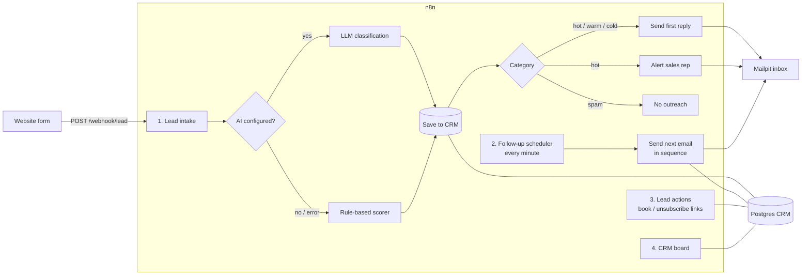
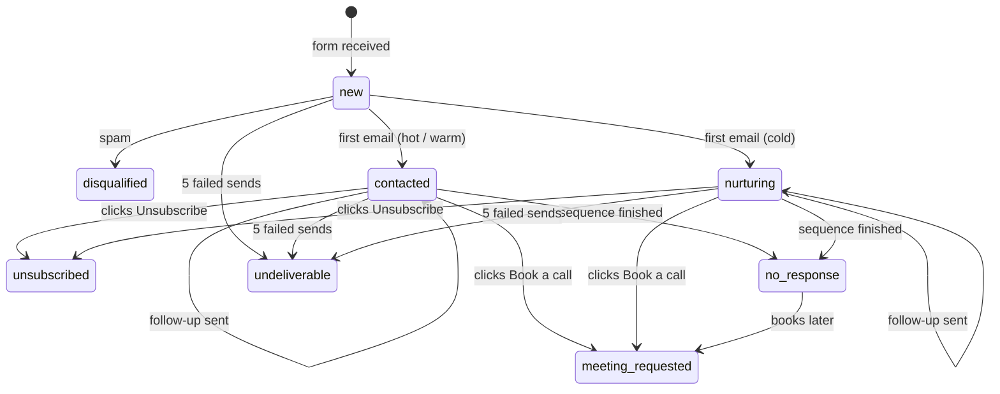

# AI Lead Automation with n8n

An n8n project that takes an inbound lead from a website form and handles everything a sales team usually does by hand in the first few days:

1. **Capture**: a webhook receives the form, validates it and filters out bots.
2. **Classify**: an LLM scores the lead and sorts it into hot, warm, cold or spam, with a short summary for the sales rep. If no AI key is configured, or the model call fails, a rule-based scorer takes over.
3. **CRM**: the lead is saved to a Postgres CRM with its score, owner and status, and every step is logged in an activity table.
4. **Follow up**: the lead gets a personal first reply straight away, hot leads trigger an alert to their sales rep, and a scheduler sends the rest of the email sequence until the lead books a call, unsubscribes or the sequence runs out.

Everything runs locally with Docker: n8n, Postgres as the CRM, and Mailpit to catch the emails so nothing is sent for real.



## What you can see in the demo

| Lead | What happens |
| --- | --- |
| Head of Operations asks for a demo and pricing this week | **hot**, assigned to a rep, rep gets an alert, lead gets a reply with a booking link, follow-ups after 1 and 3 days |
| Small agency asks how the tool connects to Google Sheets | **warm**, assigned to a rep, reply plus follow-ups after 3 and 7 days |
| Student researching a thesis | **cold**, gentle reply, slower nurture sequence (7 and 21 days) |
| SEO agency selling backlinks | **spam**, stored as disqualified, no emails |
| Bot that fills the hidden `_hp` field | **spam**, the AI is not even called |
| Form without an email address | rejected with HTTP 422 and a list of errors |
| Same person submits again | recognised as a duplicate, logged, no second email |

With `DEMO_FAST_FOLLOW_UPS=true` (the default) one sequence "day" is one minute, so you can watch a whole sequence arrive in Mailpit within a few minutes. **Book a call** in any email opens a short confirmation page. Confirming marks the lead as `meeting_requested`, stops the follow-ups, tells the owner and forwards to the calendar. **Unsubscribe** works the same way and stops the follow-ups as well.

## Quick start

You need Docker with Compose v2. On Windows, Docker Desktop with Git Bash works fine.

```bash
git clone https://github.com/PallasAthena-prog/n8n-ai-lead-automation.git
cd n8n-ai-lead-automation
cp .env.example .env
# edit .env: set N8N_ENCRYPTION_KEY to a long random string (openssl rand -hex 24)
# optional: set LLM_API_KEY to use a real model
docker compose up -d
```

On the first start a short-lived `n8n-import` container loads the credentials and the four workflows and publishes them, so there is nothing to click. After about a minute:

| What | Where |
| --- | --- |
| n8n editor (create your owner account on first visit) | http://localhost:5678 |
| Mailpit inbox | http://localhost:8025 |
| CRM board | http://localhost:5678/webhook/crm |
| CRM database | `localhost:5433`, user `crm`, database `crm` |

Send the sample leads:

```bash
bash scripts/send-sample-leads.sh
```

Each request answers right away with the result, for example:

```json
{ "ok": true, "leadId": "1", "category": "hot", "score": 100, "owner": "alex@northwind.test", "classifiedBy": "rules" }
```

Then look at the emails in Mailpit, refresh the CRM board, or print the database tables:

```bash
bash scripts/show-crm.sh
```

To send your own lead:

```bash
curl -X POST http://localhost:5678/webhook/lead \
  -H "Content-Type: application/json" \
  -d '{"name": "Ana Silva", "email": "ana@acme-freight.com", "company": "Acme Freight", "message": "Can we see a demo next week?"}'
```

The webhook also accepts normal HTML form posts (`application/x-www-form-urlencoded`), so a plain `<form action=".../webhook/lead" method="post">` works too.

## The workflows

### 1. Lead Intake & Qualification
`POST /webhook/lead`

- **Validate & Normalize** trims and lowercases the input, checks the email and name, reads UTM fields and flags free email providers. If `LEAD_WEBHOOK_SECRET` is set, the request must carry a matching `X-Webhook-Secret` header.
- **Find Existing Lead** looks the email up in the CRM. Known leads keep their original enquiry, the new message is logged as a resubmission, and no second email goes out.
- **Build AI Request / AI: Classify Lead** calls any OpenAI-compatible chat API in JSON mode. Only the email domain is sent to the model, never the full address or phone number, and the prompt tells the model to treat the form fields as data, not instructions.
- **Finalize Classification** validates the model's answer (category, score range, field lengths). If AI is switched off, the call fails, or the answer is unusable, the rule-based scorer runs instead, and the reason is stored with the lead. It also picks an owner for hot and warm leads, always the same rep for the same email.
- **Save Lead to CRM** inserts the lead (including the personal opening, so a retried email reads the same) and its first activity in one statement. The new lead is also handed to the scheduler as a safety net: if n8n stops before the first email goes out, the scheduler sends it 30 minutes later.
- **Respond: Lead Accepted** answers the form before any email is sent, so the visitor never waits on SMTP.
- **Route by Category** sends hot, warm and cold leads their first email (step 0 of their sequence). Hot leads also trigger **Alert Sales Rep**. Spam stops here. The lead's own email runs first, and a failed alert is logged without stopping anything.
- **Mark Contacted & Schedule** sets the status and the time of the first follow-up. If the first email fails, the lead stays `new` and the scheduler retries it 10 minutes later.

### 2. Follow-up Scheduler
Runs every minute.

- **Claim Due Follow-ups** picks up to 10 leads whose next email is due with `FOR UPDATE SKIP LOCKED` and leases them for 30 minutes. Two overlapping runs can never email the same lead twice, and if a run dies halfway the lead simply becomes due again.
- **Render Follow-up Emails** fills in the template for that step.
- **Send Follow-up** sends it. An email only counts as sent when the SMTP server returns a message id. Anything else goes to **Retry Later**, which tries again every 10 minutes and marks the lead `undeliverable` after the fifth failure.
- **Record Follow-up** stores the step that was sent and schedules the next one, or marks the lead `no_response` when the sequence is finished. Each lead is recorded on its own, so one bad row cannot undo the others.

### 3. Lead Actions (Book / Unsubscribe)
`GET /webhook/lead-action?lead=<id>&token=<uuid>&action=book|unsubscribe`

Every email contains these two links. The token is a random UUID stored per lead, so links cannot be guessed by changing the id.

Opening a link only shows a confirmation page; the change happens when the person clicks the button on it, which sends a POST to the same URL. Company mail filters such as Microsoft Safe Links open every link in incoming email, so a link that acted on a plain GET would unsubscribe people or fake meeting requests.

After confirming, **Book** sets the lead to `meeting_requested`, emails the owner (only the first time, and the result is logged) and redirects to `BOOKING_URL`. **Unsubscribe** shows a short "you're unsubscribed" page. Both stop the follow-ups.

### 4. CRM Board
`GET /webhook/crm`

A read-only HTML page with pipeline counts and the latest 200 leads. Set `CRM_BOARD_TOKEN` to require `?token=...`.

## Lead lifecycle



## Email sequences

The copy and timing live in the `sequence_steps` table in [db/init.sql](db/init.sql), not in the workflows, so marketing can change them with a SQL update. Removing the last steps of a sequence simply ends it earlier for leads that reach that point.

| Category | Step 0 | Step 1 | Step 2 |
| --- | --- | --- | --- |
| hot | immediately | +1 day | +3 days |
| warm | immediately | +3 days | +7 days |
| cold | immediately | +7 days | +21 days |

Placeholders: `{{first_name}}`, `{{lead_company}}`, `{{our_company}}`, `{{sender_name}}`, `{{opening}}` (the personal first sentences written by the model) and `{{booking_link}}`. Values are HTML-escaped before they go into an email.

## Configuration

All settings are environment variables in `.env`.

| Variable | Default | Purpose |
| --- | --- | --- |
| `N8N_ENCRYPTION_KEY` | (required) | Encrypts the credentials stored by n8n |
| `LLM_API_KEY` | empty | Turns on AI classification. Empty means rule-based only |
| `LLM_BASE_URL` | `https://api.openai.com/v1` | Any OpenAI-compatible endpoint (Groq, OpenRouter, Ollama, ...) |
| `LLM_MODEL` | `gpt-4o-mini` | Model name for that endpoint |
| `COMPANY_NAME`, `COMPANY_DESCRIPTION` | Northwind Analytics | Used in the prompt and in emails |
| `SENDER_NAME`, `SENDER_EMAIL` | Maya from Northwind | From address of lead emails |
| `SALES_REPS` | two example reps | Comma-separated list. Hot and warm leads are shared between them |
| `BOOKING_URL` | example calendar link | Where **Book a call** sends the lead |
| `DEMO_FAST_FOLLOW_UPS` | `true` | One sequence day = one minute |
| `PUBLIC_BASE_URL` | `http://localhost:5678` | Base of the links inside emails |
| `LEAD_WEBHOOK_SECRET` | empty | Requires the `X-Webhook-Secret` header on the intake webhook |
| `CRM_BOARD_TOKEN` | empty | Requires `?token=` on the CRM board |
| `CRM_DB_PASSWORD` | `crm_dev_password` | CRM database password (letters and digits) |

To use a local model with Ollama, set `LLM_API_KEY=ollama`, `LLM_BASE_URL=http://host.docker.internal:11434/v1` and a model you have pulled, for example `LLM_MODEL=llama3.1`.

## Design decisions

- **AI is optional, never a single point of failure.** The model only adds a better score and a personal opening. Validation, routing and the whole follow-up machinery work without it, and every lead records whether it was classified by the model or by the rules, and why.
- **Answer the form first, then do the slow work.** The webhook responds as soon as the lead is safely in the CRM.
- **The database is the source of truth.** Statuses, schedule and sequence copy all live in Postgres, so the workflows stay small and a crash never loses state. Each lead has a full activity log.
- **Safe to run in parallel, safe to crash.** Follow-ups are claimed atomically with a lease, failed sends are retried with a limit, and duplicate submissions are caught both before classification and by a unique constraint.
- **Links in emails never act on their own.** A confirmation step keeps mail scanners from unsubscribing people or booking calls for them.
- **Minimal data to the model.** No email addresses or phone numbers go to the LLM, and its output is validated before it is used.

## Using a real CRM instead

Postgres keeps the demo self-contained. To push leads into HubSpot, Pipedrive or Salesforce as well, add the matching n8n node after **Save Lead to CRM** (for HubSpot: *Create or Update Contact*, mapping email, name, company and a custom `lead_score` property), and keep Postgres as the place where the sequence state lives. To send real emails, point the **Mailpit SMTP** credential at your SMTP provider and set `DEMO_FAST_FOLLOW_UPS=false`.

## Project structure

```
.
├── docker-compose.yml          n8n, Postgres CRM, Mailpit and the one-time importer
├── .env.example                all settings with working defaults
├── db/init.sql                 CRM schema, activity log and email sequences
├── n8n/
│   ├── import.sh               imports credentials and workflows on first start
│   ├── credentials.template.json
│   └── workflows/              the four workflows as n8n JSON
├── scripts/
│   ├── send-sample-leads.sh    one lead of each kind
│   └── show-crm.sh             prints leads, pipeline and recent activity
└── docs/architecture.md        data model and request flow
```

## Troubleshooting

- **`n8n-import` exited with an error**: run `docker compose logs n8n-import`. Starting over is safe: `docker compose down -v && docker compose up -d` (this deletes the demo data).
- **The webhook returns 404**: the workflows are not published yet. Check `docker compose logs n8n` or open the editor and publish *1. Lead Intake & Qualification*.
- **Every lead says `classifiedBy: rules`**: no `LLM_API_KEY` is set, or the model call failed. The reason is in the `fallback_reason` of the lead's `created` activity (`bash scripts/show-crm.sh`).
- **Scripts fail on Windows with `$'\r': command not found`**: the files were checked out with Windows line endings. The `.gitattributes` file prevents this for new clones. For an existing clone run `git add --renormalize .` and check out again.
- **Changed `.env` but nothing happened**: run `docker compose up -d` again so the containers pick up the new values.

## Ideas for next steps

- Enrich leads from the company domain (size, industry) before scoring
- Read real replies from an IMAP inbox and stop the sequence when someone answers
- Post hot leads to Slack or Microsoft Teams as well as email
- A/B test subject lines by adding a variant column to `sequence_steps`

## License

MIT, see [LICENSE](LICENSE).
