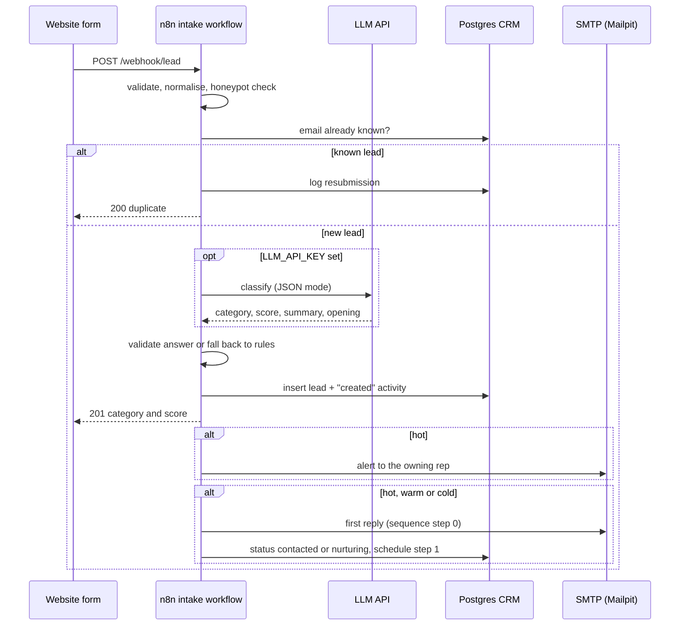
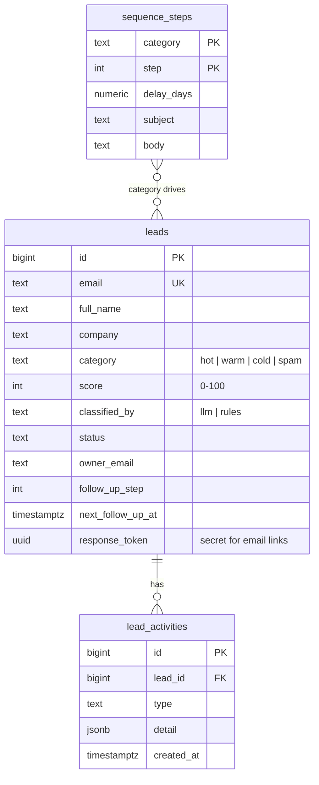

# Architecture

## Containers

| Service | Image | Role |
| --- | --- | --- |
| `n8n` | `n8nio/n8n:2.46.3` | Runs the four workflows. Webhooks on port 5678 |
| `n8n-import` | same image | Runs once on a fresh volume: imports credentials and workflows, publishes them, exits |
| `postgres` | `postgres:17.11-alpine` | The CRM. Schema in `db/init.sql` |
| `mailpit` | `axllent/mailpit:v1.32.0` | Fake SMTP server with a web inbox on port 8025 |

n8n keeps its own data (users, executions, encrypted credentials) in SQLite on the `n8n-data` volume. The CRM data is on `crm-data`. `docker compose down -v` removes both.

## Request flow for a new lead



## Data model



Activity types written by the workflows: `created`, `resubmitted`, `email_sent`, `email_failed`, `sales_alert_sent`, `sales_alert_failed`, `follow_up_sent`, `meeting_requested`, `unsubscribed`, `owner_notified`, `owner_notify_failed`.

Statuses: `new`, `contacted`, `nurturing`, `meeting_requested`, `no_response`, `unsubscribed`, `undeliverable`, `disqualified`.

## Follow-up scheduling

`next_follow_up_at` is the only thing the scheduler looks at, together with `follow_up_step` (the last step that was sent).

- When an email goes out, `follow_up_step` becomes that step and `next_follow_up_at` becomes `now() + delay_days` of the next step.
- When the scheduler claims a lead, it moves `next_follow_up_at` 30 minutes ahead. That is a lease: a second run cannot pick the lead up, and if the run crashes the lead is simply due again later. The trade-off is that a crash between sending and recording can repeat one email.
- A failed send sets the time 10 minutes ahead. After five failures of the same email the lead becomes `undeliverable`.
- A new lead is saved with `follow_up_step` -1 and a 30 minute lease, and if its first email fails the lease becomes 10 minutes. Either way the scheduler then sends step 0 with the same personal opening, so a lead can never be left without its first email.
- An email only counts as sent when the SMTP server returned a message id.
- If the next step of a sequence no longer exists in `sequence_steps`, the sequence ends there (status `no_response`).
- It is cleared when the lead books a call or unsubscribes, and after the last step of the sequence (status `no_response`).

With `DEMO_FAST_FOLLOW_UPS=true` the delay unit is one minute instead of one day. The unit is passed into the SQL as an interval, so nothing else changes between demo and real timing.

## Useful queries

```sql
-- leads waiting for a follow-up, soonest first
select id, full_name, category, follow_up_step, next_follow_up_at
  from leads where next_follow_up_at is not null order by next_follow_up_at;

-- full history of one lead
select type, detail, created_at from lead_activities where lead_id = 1 order by id;

-- how leads were classified, and why the rules were used
select classified_by, count(*) from leads group by 1;
select detail->>'fallback_reason' as reason, count(*)
  from lead_activities where type = 'created' group by 1;

-- change the timing of the hot sequence
update sequence_steps set delay_days = 2 where category = 'hot' and step = 1;
```
